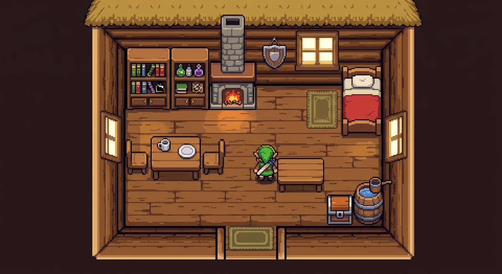

# Direction artistique

Ce guide fixe l'apparence du jeu. Il part de deux images de référence :

- [`images/image_maison.jpg`](images/image_maison.jpg) : l'intérieur d'une maison, pour le décor et la lumière ;
- [`images/forgeron_sample.jpg`](images/forgeron_sample.jpg) : des sprites de forgeron, pour les personnages. C'est une **inspiration** : nos personnages sont des **hommes aux proportions d'adulte** (pas des nains), et leurs mouvements sont mieux décomposés que dans l'image.

Tout nouvel élément dessiné doit leur ressembler.



## Le style en une phrase

Un **pixel art net et chaleureux**, vu de dessus en trois-quarts, fait de **bois** (sol en planches, murs en rondins, meubles), de **chaume** et de **pierre**, avec quelques touches de couleur franches (couverture rouge, livres, flacons, flammes) et une **lumière chaude**.

## Les règles

- **Tuile de base : 32×32 pixels.** Les nouveaux dessins (les personnages, l'enclume) partent de cette grille. La taille a été choisie en comparant un même forgeron dessiné sur une tuile de 32 et sur une tuile de 64 : voir [`images/samples/comparaison_zoom_de_depart_64.png`](images/samples/comparaison_zoom_de_depart_64.png) et [`images/samples/comparaison_32_vs_64.png`](images/samples/comparaison_32_vs_64.png).
- **Pixels nets.** Le dessin est affiché sans aucun lissage, à une **échelle entière** : chaque pixel du dessin devient un carré de 1×1, 2×2, 3×3 ou 4×4 pixels d'écran. Le zoom à la molette a donc quatre paliers : 32, **64** (départ), 96 et 128 pixels par tuile.
- **Les anciens dessins sur 16 pixels** (les habitats) sont affichés **deux fois plus gros** pour occuper la même place, et restent nets. On voit donc pour l'instant deux tailles de pixels à l'écran ; ils seront redessinés à 32 pixels.
- **Palette limitée et partagée.** Les couleurs sont celles du tableau ci-dessous, définies une seule fois dans `crates/afk-game/src/sprites.rs`. Un sprite n'en utilise pas d'autre ; un test le vérifie.
- **Un bois, trois ou quatre tons.** Clair pour les arêtes, moyen pour les surfaces, foncé pour les joints et les ombres. Le bois d'un lit, d'une table et d'un mur vient de la même gamme.
- **Contours sombres** là où un objet se détache d'un fond (le baquet, un personnage), ombres dures d'un pixel sous les meubles.
- **Lumière chaude.** Les intérieurs sont plus chaleureux que l'extérieur ; le feu de la cheminée et les fenêtres éclairées de nuit teintent le sol d'ambre.
- **Vue en coupe des maisons.** Bande de toit de chaume et mur de rondins au nord, murs de bois à l'ouest et à l'est, mur sud bas avec la porte, sol en planches.
- **Tout peut être tourné.** Les meubles se posent dans quatre orientations ; leur dessin suit.
- **Un élément à la fois.** Le style s'étend petit à petit. Un élément pas encore redessiné garde son ancien aspect, mais **un même bâtiment ne mélange jamais les deux styles**.

## Les personnages

Tous les personnages suivent le même gabarit, défini une fois dans `crates/afk-game/src/character_sprites.rs` :

- **Une cellule de 64×64** (2×2 tuiles). Les **pieds** sont au point (32, 58) de la cellule, posé sur la position du personnage : sa tête dépasse sur la tuile du dessus. Un homme debout mesure environ 1,7 tuile.
- **Une planche par métier** : une ligne par animation, une colonne par image.

  | Ligne | Animation | Images |
  |---|---|---|
  | 0 | `debout_bas`, `debout_haut`, `debout_droite`, `debout_gauche` | 1 par direction |
  | 1 à 4 | `marche_bas`, `marche_haut`, `marche_droite`, `marche_gauche` | 4 : contact jambe gauche, croisé, contact jambe droite, croisé |
  | 5 | `repos` (face vers le bas) | 4 : neutre, inspiration, neutre, clignement |
  | 6 | `sommeil` (couché tête en haut, dans un lit d'une tuile de large) | 2 |
  | 7 | `travail`, propre au métier | 6 pour le forgeron : marteau bas, lever, haut, descente, impact, rebond |
  | 8 | objets du métier (l'`enclume`) | 1 chacun |

- **Une marche bien décomposée** : jamais la même jambe en avant sur deux pas qui se suivent, les bras à l'opposé des jambes.
- **Un visage soigné et constant** : le même sur toutes les images de face (seul le clignement change). Dans le SVG, la tête est une pièce commune réutilisée par chaque image.
- **L'ombre au sol** n'est pas dans le dessin : le jeu la pose sous les pieds.
- **Le forgeron forge de face**, à son poste, juste derrière l'enclume : ses pieds sont 2 pixels au-dessus de la case de l'enclume, qui est dessinée devant lui et cache ses jambes. Ses images de forge ont le corps à la même hauteur que l'image debout : rien ne saute quand il se met à forger.

### Le dessin : un SVG, des PNG générés

La source d'un personnage est un fichier SVG : `crates/afk-game/assets/characters/<métier>.svg`. Il se modifie dans Inkscape ou dans un éditeur de texte :

- chaque image est un groupe `<g id="marche_bas_2">`, placé dans sa cellule ;
- les pièces communes (têtes, torses...) sont dans `<defs>` et réutilisées par `<use>` : modifier une tête la modifie partout ;
- seules les couleurs de la palette sont permises, et les formes sont rendues sans lissage (`shape-rendering="crispEdges"`) ;
- inutile de dessiner le **contour sombre extérieur** ni la **marche vers la gauche** : la génération les ajoute (la gauche est le miroir de la droite, sauf si le SVG dessine `marche_gauche_*` ou `debout_gauche`).

Puis :

```
sprites.bat            régénère les PNG et un aperçu agrandi : target/sprites-preview/<métier>.html
sprites.bat --check    vérifie seulement que les PNG commités correspondent à leur SVG
```

Le PNG est commité à côté du SVG, et le jeu l'embarque. Un test échoue si le PNG ne correspond plus à son SVG, si une image manque, ou si un pixel est hors palette ou à moitié transparent : l'erreur donne sa position.

## La palette

| Lettre | Couleur | Usage |
|---|---|---|
| `k` | `#2a1a12` | contour sombre |
| `W` `w` `d` `D` | `#d9a557` `#b27a3c` `#7a4a22` `#4a2c14` | bois : clair, moyen, foncé, ombre |
| `T` `t` `h` | `#d8b04a` `#b88a2e` `#8a6420` | chaume : clair, moyen, foncé |
| `S` `s` `z` | `#9a9a9c` `#727276` `#4a4a50` | pierre : claire, moyenne, foncée |
| `R` `r` | `#c8323c` `#8e1f2a` | rouge de la couverture |
| `F` `f` | `#f0ead8` `#cbbfa3` | blanc cassé, crème (oreiller, assiette, chemise) |
| `G` `g` | `#4c9a3c` `#2f6b2a` | vert |
| `B` `b` | `#4a86c8` `#8cc0ec` | eau, eau claire |
| `M` `m` | `#8a8f9a` `#5a5f6a` | métal (cerclage, poignées, marteau) |
| `u` `Y` `y` | `#a9d2ec` `#ffe9a0` `#f5c25a` | vitre de jour, vitre éclairée, lueur ambrée |
| `O` `o` `e` | `#ff9a2a` `#ffd23c` `#d8541a` | flammes, braises, métal chaud |
| `L` `N` `P` `Q` | `#3a5fa8` `#a8403a` `#8a4ab0` `#4cb05a` | livres bleu et brun, flacons violet et vert |
| `C` `c` | `#8a8a3a` `#5e5e26` | tapis olive |
| `A` `a` `I` | `#f4c496` `#dea070` `#aa6846` | peau : claire, moyenne, dans l'ombre |
| `H` `j` `J` | `#84522c` `#643a1e` `#422412` | cheveux et barbe |
| `E` `l` `n` | `#966034` `#764624` `#4e2c16` | cuir (tablier, ceinture) |
| `V` `v` `x` | `#5c5c6c` `#444452` `#2e2e3a` | tissu (pantalon) |
| `i` | `#96886c` | chemise dans l'ombre |

## Où est le code

- `crates/afk-game/src/sprites.rs` : la palette, les dessins de 16 pixels (habitats, en rectangles), leur rotation exacte et leur affichage net.
- `crates/afk-game/src/habitat_view.rs` : la coupe d'une maison (sol, murs, toit, fenêtres, cheminée, paillasson, meubles) et sa lumière.
- `crates/afk-game/src/character_sprites.rs` : le gabarit des personnages (cellule, ancrage, animations).
- `crates/afk-game/src/character_view.rs` : l'affichage des planches de personnages et de l'enclume.
- `crates/afk-game/src/spritegen.rs` et `src/bin/spritegen.rs` : la conversion SVG → PNG (`sprites.bat`).
- `crates/afk-game/src/camera.rs` : la tuile de base et les paliers de zoom entiers.

## Ce qui est déjà dans ce style

Les **habitats** (toutes les maisons, mines et cabanes, encore sur 16 pixels), le **forgeron** et l'**enclume**. Le terrain, les arbres, les champs, les filons, les coffres, la forge, la taverne, les autres personnages et l'interface gardent leur apparence d'avant, jusqu'à ce qu'on les redessine à leur tour. Le **château** n'est pas touché : il aura son propre fonctionnement.

## Pour ajouter un dessin

Un objet ou un meuble :

1. Le dessiner avec des couleurs de la palette, sur une grille multiple de la tuile.
2. Pour un dessin de `sprites.rs`, le ranger dans `all_pixel_sprites` pour que le test de palette le vérifie.
3. L'afficher à une échelle entière ; pour un objet orientable, passer par `Turns`.
4. Regarder le résultat à plusieurs zooms : les pixels doivent rester carrés et nets.

Un personnage :

1. Partir du SVG d'un personnage existant (`forgeron.svg`), le copier sous le nom du métier et changer ses vêtements, ses couleurs et son animation de travail.
2. Déclarer sa planche dans `character_sprites.rs` (`SheetSpec` et `SHEETS`) et la charger dans `character_view.rs`.
3. Lancer `sprites.bat`, relire l'aperçu (visage, alternance des jambes, pieds sur l'ancre magenta), puis lancer les tests.
